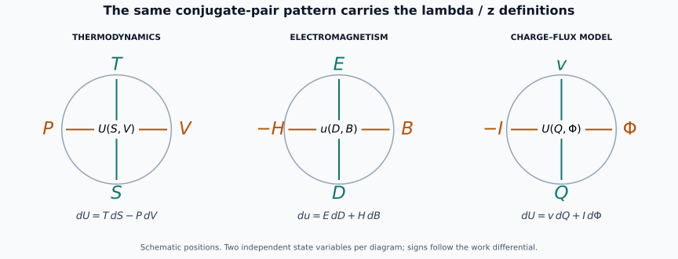

# NSR2: the lambda and z properties transfer with the conjugate diagram

Monty Dabas. 5 October 2026. **Python 3.12 only.**

The question here is the direct one: can the actual lambda_P, lambda_V,
lambda_S, z_T, z_S and lambda_T coordinates of the T–V–S–P diagram be
reconstructed on another diagram? **Yes, whenever it carries two work-conjugate
pairs and the same regular Legendre-potential structure.** This chapter writes
that transfer explicitly. NSR1's response curvature is a later layer.

The compass positions retain the order T,V,S,P. The drawings are schematic:
angles and radii do not identify dimensional physical quantities. Each
four-label diagram describes overlapping charts of a two-dimensional state
surface, with other state variables held fixed.

## 1. The common grammar of the diagrams

Let U(x,y) be a C3 potential with

\[
dU=p\,dx+q\,dy,\qquad p=U_x,\quad q=U_y,\qquad
D^2U=\begin{pmatrix}a&b\\b&c\end{pmatrix},\quad
\Delta=ac-b^2>0,\quad a>0.                             \tag{1}
\]

The stable Hessian ensures that all charts used below are locally regular.
The signed compass is **(p,y,x,-q)** in the positions (T,V,S,P).

| Diagram | x (S slot) | y (V slot) | p (T slot) | -q (P slot) | Work differential |
| --- | --- | --- | --- | --- | --- |
| Thermodynamic | S | V | T | P | dU=T dS-P dV |
| Electromagnetic, one chosen pair of components | D | B | E | -H | du=E dD+H dB |
| Conservative charge–flux circuit model | Q | Φ | v | -I | dU=v dQ+I dΦ |
| Two elastic strain coordinates, fixed remaining variables | ε₁ | ε₂ | σ₁ | -σ₂ | dw=σ₁ dε₁+σ₂ dε₂ |

For the electromagnetic row U is replaced by the chosen energy density u.
The Hamiltonian electromagnetic convention is [1], equations (1.8)–(1.9).
The other rows specify the conjugate convention of a conservative model;
they do not assert that an arbitrary dissipative circuit or material admits
one such two-variable potential.

**NSR2-T1: four-potential transfer.** Define

\[
F_x=U-px,\qquad F_y=U-qy,\qquad G=U-px-qy.
\]

Then

\[
\begin{array}{ll}
dU=p\,dx+q\,dy,&dF_x=-x\,dp+q\,dy,\\
dF_y=p\,dx-y\,dq,&dG=-x\,dp-y\,dq.
\end{array}                                           \tag{2}
\]

In the thermo adapter these are U,F,H_thermo,G. In electromagnetism they
are u, u-ED, u-HB, u-ED-HB. They give all four Maxwell-type mixed-partial
relations in their respective regular charts.

**Proof.** Differentiate each Legendre expression and cancel the px or qy
terms using (1). The Jacobian determinants for (x,q), (p,y), (p,q) relative
to (x,y) are c, a and Δ, respectively. They are nonzero by stability, so
the inverse function theorem gives the required local charts. Equality of
mixed partial derivatives in each chart gives the Maxwell-type relations. ∎

Thus the transferable structure is exactness and conjugacy. A physical
rotation or reflection symmetry need not exchange the two material channels.

## 2. The six properties, with the held variable kept explicit

**NSR2-T2: six-response transfer.** Pull every potential back to the
indicated chart before differentiating. In the plus-sign convention (1),

| Property in the new diagram | Definition | Formula | Dimension |
| --- | --- | --- | --- |
| λ_q | (∂G/∂x)_q | -xΔ/c | p |
| λ_y | (∂F_x/∂x)_y | -xa | p |
| λ_x | (∂F_y/∂y)_x | -yc | q |
| z_p | (∂G/∂y)_p | -yΔ/a | q |
| z_x | (∂U/∂q)_x | q/c | y |
| λ_p | (∂F_x/∂q)_p | qa/Δ | y |

These are notation introduced for this transfer, not six standard names
asserted to exist in every subject. Their definitions carry the content.

**Proof.** From dp=a dx+b dy and dq=b dx+c dy, holding q fixed gives
(∂p/∂x)_q=Δ/c, while holding p fixed gives (∂q/∂y)_p=Δ/a. The other
two direct stiffnesses are a and c. Substitute these derivatives into (2).
At fixed x, dU=q dy and dy/dq=1/c. At fixed p, dF_x=q dy and
dy/dq=a/Δ. These prove the last two rows, with all signs determined by
the plus-sign work convention. The units follow from [U]=[p][x]=[q][y]. ∎

The precise recovery of the original thermo properties is

\[
(\lambda_q,\lambda_y,\lambda_x,z_p,z_x,\lambda_p)
\big|_{x=S,y=V,p=T,q=-P}
=(\lambda_P,\lambda_V,\lambda_S,z_T,-z_S,-\lambda_T).
                                                               \tag{3}
\]

The last two minus signs are essential: the original paper differentiates
with respect to physical P, whereas the generic convention differentiates
with respect to q=-P. Holding -P fixed is the same constraint as holding P
fixed, but differentiation with respect to -P reverses the derivative sign.

## 3. The electromagnetic lambda dictionary

Write a=u_DD, b=u_DB, c=u_BB and Δ=ac-b² for a fixed reversible preparation.
Let Φ_D=u-ED, Φ_B=u-HB and Φ_DB=u-ED-HB. Define the differential responses

\[
\epsilon_B=(\partial D/\partial E)_B=1/a,\qquad
\epsilon_H=(\partial D/\partial E)_H=c/\Delta,
\]
\[
\mu_D=(\partial B/\partial H)_D=1/c,\qquad
\mu_E=(\partial B/\partial H)_E=a/\Delta.                \tag{4}
\]

The exact counterpart list is:

| Thermo property | EM definition in positive H convention | EM formula |
| --- | --- | --- |
| λ_P=(∂G/∂S)_P | λ_H^em=(∂Φ_DB/∂D)_H | -D/ε_H |
| λ_V=(∂F/∂S)_V | λ_B^em=(∂Φ_D/∂D)_B | -D/ε_B |
| λ_S=(∂H_thermo/∂V)_S | λ_D^em=(∂Φ_B/∂B)_D | -B/μ_D |
| z_T=(∂G/∂V)_T | z_E^em=(∂Φ_DB/∂B)_E | -B/μ_E |
| z_S=(∂U/∂P)_S | z_D^em=(∂u/∂H)_D | Hμ_D |
| λ_T=(∂F/∂P)_T | λ_E^em=(∂Φ_D/∂H)_E | Hμ_E |

The last two EM definitions use H, not the signed compass coordinate -H;
their orientation is handled exactly as in (3). The first pair has electric
field units, the second magnetic field units, and the third magnetic-flux
density units. The unit-typed six-component bundle of the thermo paper thus
has a direct electromagnetic counterpart.

This is the requested transfer of the properties themselves. A diagram
with two conjugate pairs produces an analogous table by replacing x,y,p,q,
while retaining the potentials, held variables, signs and unit structure.

## 4. Products, closure and higher derivatives also transfer

**NSR2-T3: identities and Jacobian rule.** In the generic convention,

\[
\lambda_q\frac{c}{\Delta}=\lambda_y\frac1a=-x,\qquad
\lambda_xz_x=\lambda_pz_p=-yq,                         \tag{5}
\]

\[
\boxed{\lambda_q\lambda_x=\lambda_y z_p.}              \tag{6}
\]

Where x and y are nonzero, the original reciprocal ratio pattern becomes

\[
\Gamma_1=\frac{\lambda_q}{\lambda_y}=\frac{\Delta}{ac},
\qquad
\Gamma_2=\frac{\lambda_x}{z_p}=\frac{ac}{\Delta},
\qquad \boxed{\Gamma_1\Gamma_2=1}.                     \tag{7}
\]

Equation (6) remains valid at zero x or y; a 0/0 quotient must not be
reported there as a measured ratio. The Hessian expressions on the right
provide regular extensions. In electromagnetism (5) gives -BH in the last
pair, an energy density, and (7) gives
(ε_B/ε_H)(μ_E/μ_D)=1. Equation (3) recovers the thermo products -PV.

Every constrained derivative can be generated by the same Jacobian rule:

\[
\boxed{\left(\frac{\partial f}{\partial g}\right)_h
 =\frac{f_xh_y-f_yh_x}{g_xh_y-g_yh_x},}
\quad g_xh_y-g_yh_x\ne0.                              \tag{8}
\]

**Proof.** Substitute the six formulas into (5)–(7). For (8), the vector
v=(h_y,-h_x) is tangent to a fixed-h curve; df(v)/dg(v) gives the result.
Nonzero denominator makes (g,h) a regular chart. Reapply the chain and
quotient rules to obtain higher constrained responses whenever the required
derivatives and denominators exist. ∎

The native covariant tower transfers too: first nondimensionalize the six
components with their declared force/coordinate scales, then choose the
same kind of fibre and base connections as NT-8. Its product rule and
curvature action on each tensor slot are unchanged. Ordinary repeated
partial derivatives and covariant derivatives are different operations;
the connection and chart must accompany any tower claimed to be covariant.

## 5. What the transferred properties look like in models

**NSR2-T4: linear and coupled examples.** For a linear electromagnetic
energy u=D²/(2ε)+B²/(2μ), with positive constant ε and μ,

\[
(\lambda_H^{em},\lambda_B^{em},\lambda_D^{em},z_E^{em},
 z_D^{em},\lambda_E^{em})=(-E,-E,-H,-H,B,B).             \tag{9}
\]

Thus replication can yield familiar fields rather than six independent
material coefficients. With mixed response the constrained pairs separate:

\[
\lambda_q-\lambda_y=\frac{x b^2}{c},\qquad
z_p-\lambda_x=\frac{y b^2}{a},\qquad
\lambda_p-z_x=\frac{q b^2}{c\Delta}.                   \tag{10}
\]

Their signs follow the signs of x,y,q. Separability b=0 is sufficient for
these differences to vanish even if the two uncoupled channels are nonlinear.

For the normalized Born–Infeld sector already derived in NSR1,
u(D,B)=√((1+D²)(1+B²))-1, take D=B=1/2. Then E=H=1/2,
a=c=4/5, b=1/5, Δ=3/5, and

| Property | Exact value |
| --- | --- |
| λ_H^em | -3/8 |
| λ_B^em | -2/5 |
| λ_D^em | -2/5 |
| z_E^em | -3/8 |
| z_D^em | 5/8 |
| λ_E^em | 2/3 |
| Γ₁, Γ₂ | 15/16, 16/15 |

An ideal conservative charge–flux model has
U(Q,Φ)=Q²/(2C)+Φ²/(2L), v=Q/C and I=Φ/L. The same six properties are
(-v,-v,-I,-I,Φ,Φ). A stable coupled local model
U=Q²/(2C)+kQΦ+Φ²/(2L), with k²<1/(CL), separates them according to
(10). This is a declared circuit energy model; realizing a given k in
hardware needs its own device model.

**Proof.** In the uncoupled cases b=0, Δ=ac; substitution gives (9) and
the circuit list. Subtract the formulas in T2 and use ac-Δ=b² to obtain
(10). Differentiating the stated Born–Infeld energy yields the displayed
Hessian and fields; either T2 or the independent Jacobian rule (8) gives
the table. ∎

## 6. Preserve the complete derivative information

**NSR2-T5: a point property list need not determine signed coupling.**
Consider the two local stable energies near x=y=1, with ξ=x-1 and η=y-1,

\[
U_\pm=2\xi+3\eta+\xi^2\pm\xi\eta+\tfrac52\eta^2.
\]

At that point both have p=2, q=3, a=2, c=5, Δ=9. All six transferred
values are identical:

\[
(-9/5,-2,-5,-9/2,3/5,2/3),                             \tag{11}
\]

but b=±1. The next derivative distinguishes them:

\[
\left(\frac{\partial z_x}{\partial x}\right)_y
=\pm\frac15.                                         \tag{12}
\]

**Proof.** The Hessians are constant positive matrices [[2,±1],[±1,5]].
Every occurrence of b in T2 at this fixed state is through b², proving
(11). In these models z_x=q/5 and q_x=±1, proving (12). ∎

This example explains why the original full Jacobian and higher response
tower should accompany the six properties. It does not claim that every
inverse constitutive problem is resolved by one more derivative.

Weighted responses also retain their coordinate origins. If δD=D-D₀ is
used as a local calculation coordinate, the original Legendre product is
E(D₀+δD). Replacing it by EδD defines a different potential and a different
weighted property. Units may be changed with the corresponding tensor
transformation; physical reference values must be carried along explicitly.

## Evidence and source order

The definitions were read directly from Publications research commit
`f0f1c1650e914b7eaf3bf64ddb7df9f543c92a56`, files
`papers/thermodynamic-response-corrections/source/sections/01_foundations.tex`
and `01a_response_summary.tex`. Their current native reconstruction is
[NT-1 and NT-8](../native-thermodynamic-curvature/THEOREM.md).
The six-property table is transferred as defined there, including the
mechanical sign and distinct units; it is not replaced by the older uniform
entropy-scaled tetrad.

The Python 3.12 verifier computes derivatives of all four potentials and
uses (8) independently of the closed formulas. It checks the original
thermodynamic signs, the electromagnetic and circuit examples, closure,
zero-coordinate boundaries and the signed-coupling pair. The five general
results above are written proofs; finite exact checks verify the stated
implementations. Prior NSR1 proofs and certificate files are unchanged.

This establishes a reusable property-generating dictionary, not external
priority or a new measured material effect. Each physical application still
supplies its potential, state restrictions and constitutive calibration.

[1] L. Mezincescu, J. G. Russo, P. K. Townsend, *Hamiltonian birefringence
and Born–Infeld limits*, https://arxiv.org/html/2311.04278v3.
Only its established electromagnetic work/constitutive convention and
Born–Infeld model are inputs; the transferred property calculations are here.
